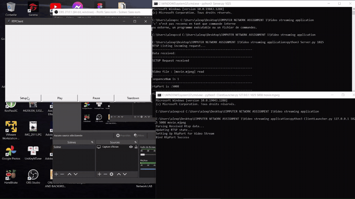
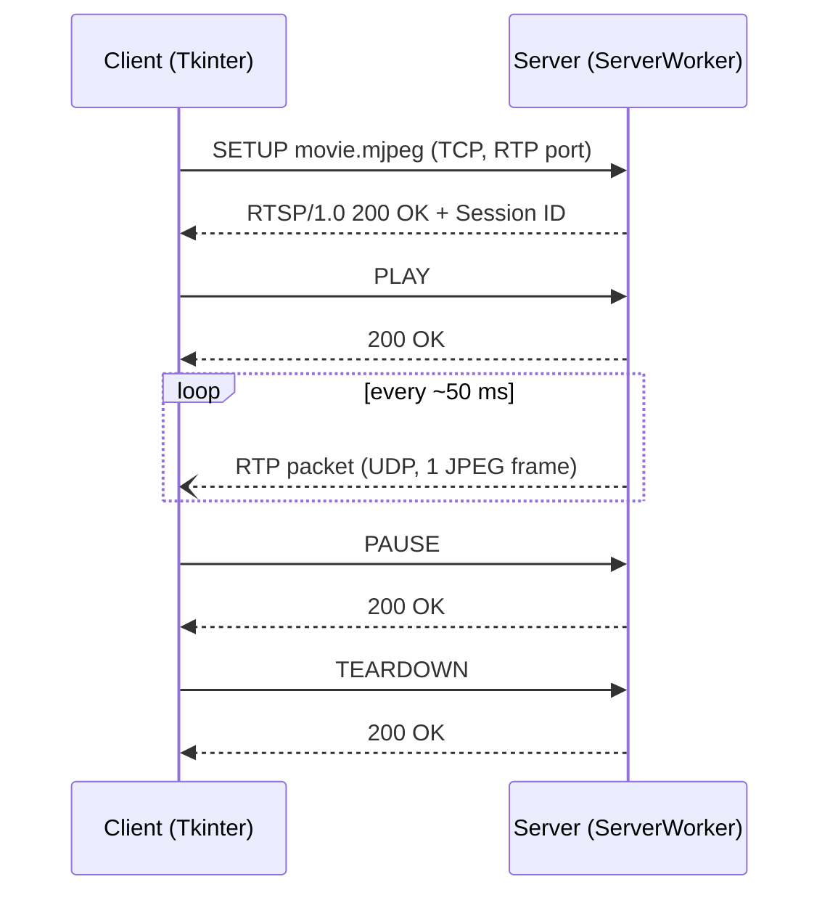
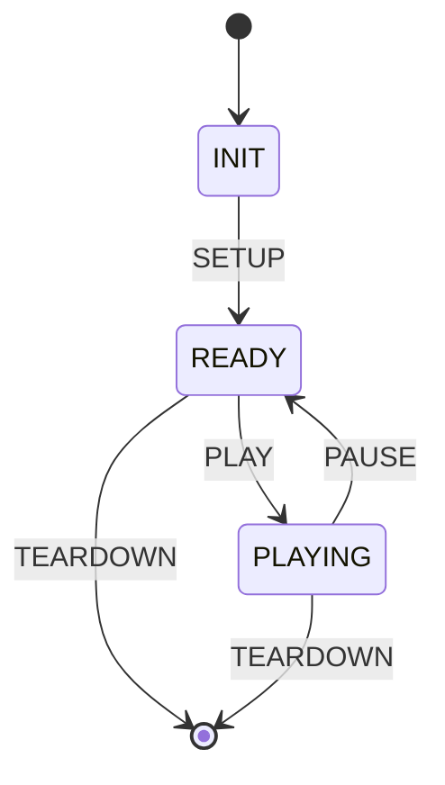

<div align="center">

# RTSP/RTP Video Streaming Application

A minimal VLC-like video streaming client/server written in Python, built on **RTSP** for session control and **RTP over UDP** for media delivery.




[Full demo video](Demo%20Streaming%20Application.mp4) · [Project report (PDF)](Report/1952001_AlexandreRousseau_Assignement1_Report.pdf)

</div>

---

## Overview

The server reads a Motion JPEG file, packetizes each frame into an RTP packet and pushes it over UDP. The client controls the session with RTSP commands (`SETUP`, `PLAY`, `PAUSE`, `TEARDOWN`) sent over TCP, then reassembles and displays the frames in a Tkinter window.

**Highlights**

- RTSP session handling with a client/server state machine
- RTP packet encoding/decoding with a hand-built 12-byte header (bit-level packing)
- Multi-client server: one worker thread per RTSP connection
- Built-in network impairment simulation: ~5% packet drop and random jitter
- Packet loss detection on the client (sequence number gaps) with loss rate reported at teardown
- Late/out-of-order packets discarded

## Architecture



**Session state machine (client and server)**



## Getting started

### Requirements

- Python 3.8+
- Tkinter (bundled with Python on Windows/macOS; on Debian/Ubuntu: `sudo apt install python3-tk`)
- Pillow

```bash
git clone https://github.com/vuong203/Video-Streaming-Application-.git
cd Video-Streaming-Application-
pip install -r requirements.txt
```

### Run

Terminal 1, start the server:

```bash
cd "Video streaming application"
python3 Server.py 1025
```

Terminal 2, start the client:

```bash
cd "Video streaming application"
python3 ClientLauncher.py 127.0.0.1 1025 5008 movie.mjpeg
```

Then click **Setup → Play**. Use **Pause** / **Play** to control playback and **Teardown** to close the session.

On Linux/macOS, `./test.sh` starts both in one go.

### Usage

```text
python3 Server.py <server_port>
python3 ClientLauncher.py <server_host> <server_port> <rtp_port> <video_file>
```

| Argument | Description |
|---|---|
| `server_port` | TCP port for RTSP. Use a port > 1024 |
| `server_host` | Server IP address |
| `rtp_port` | Local UDP port where the client receives RTP packets |
| `video_file` | `movie.mjpeg` or `movie3.mjpeg` |

## How it works

### MJPEG file format

The sample videos use a simple proprietary MJPEG container: concatenated JPEG images, each preceded by a **5-byte ASCII header** giving the frame size in bytes.

```text
[ "06014" ][ 6014 bytes of JPEG ][ "05987" ][ 5987 bytes of JPEG ] ...
```

`VideoStream.py` parses this stream frame by frame.

### RTP packet

Each frame is sent as one RTP packet (payload type 26, JPEG) with a 12-byte header packed in `RtpPacket.py`:

```text
 0                   1                   2                   3
 0 1 2 3 4 5 6 7 8 9 0 1 2 3 4 5 6 7 8 9 0 1 2 3 4 5 6 7 8 9 0 1
+-+-+-+-+-+-+-+-+-+-+-+-+-+-+-+-+-+-+-+-+-+-+-+-+-+-+-+-+-+-+-+-+
|V=2|P|X|  CC   |M|     PT      |       sequence number         |
+-+-+-+-+-+-+-+-+-+-+-+-+-+-+-+-+-+-+-+-+-+-+-+-+-+-+-+-+-+-+-+-+
|                           timestamp                           |
+-+-+-+-+-+-+-+-+-+-+-+-+-+-+-+-+-+-+-+-+-+-+-+-+-+-+-+-+-+-+-+-+
|                             SSRC                              |
+-+-+-+-+-+-+-+-+-+-+-+-+-+-+-+-+-+-+-+-+-+-+-+-+-+-+-+-+-+-+-+-+
```

The sequence number equals the frame number, which lets the client detect lost and late packets.

### RTSP commands

| Command | Client action | Server action |
|---|---|---|
| `SETUP` | Sends file name, CSeq and RTP port; opens UDP socket (0.5 s timeout) | Opens the video, generates a random session ID |
| `PLAY` | Starts the RTP listener thread | Starts the RTP sender thread |
| `PAUSE` | Stops the listener thread | Stops sending packets |
| `TEARDOWN` | Closes sockets, prints packet loss rate | Stops sending, closes the RTP socket |

The CSeq number starts at 1 and is incremented on every request. Replies follow the form:

```text
RTSP/1.0 200 OK
CSeq: 2
Session: 482913
```

### Network impairment simulation

To test robustness, `ServerWorker.sendRtp` deliberately:

- drops about **5%** of packets,
- adds random **jitter** to the ~50 ms frame interval (-13 ms to +5 ms, plus a short extra delay after each send).

The client counts sequence gaps and prints the **RTP packet loss rate** on teardown.

## Project structure

```text
.
├── Video streaming application/
│   ├── Server.py           # RTSP listener, spawns one ServerWorker per client
│   ├── ServerWorker.py     # RTSP request handling + RTP sender thread
│   ├── Client.py           # Tkinter GUI, RTSP requests, RTP receiver
│   ├── ClientLauncher.py   # Client entry point
│   ├── RtpPacket.py        # RTP header encode/decode
│   ├── VideoStream.py      # MJPEG frame parser
│   ├── movie.mjpeg         # Sample video
│   ├── movie3.mjpeg        # Sample video
│   └── test.sh             # Run server + client locally
├── Report/                 # Assignment report (PDF)
├── docs/demo.gif           # README preview
└── Demo Streaming Application.mp4
```

## Known limitations

- RTSP messages use a simplified text format, not fully RFC 2326 compliant.
- The client binds its RTP socket to the server address, so it is designed to run on `localhost`.
- The RTP timestamp uses wall-clock seconds instead of a 90 kHz media clock.
- A `404 Not Found` is logged by the server but not sent back to the client.
- No RTCP, no adaptive bitrate, no encryption (plain RTSP/RTP).

## Author

**[Alexandre Rousseau](https://github.com/vuong203)**, Computer Networks assignment.
